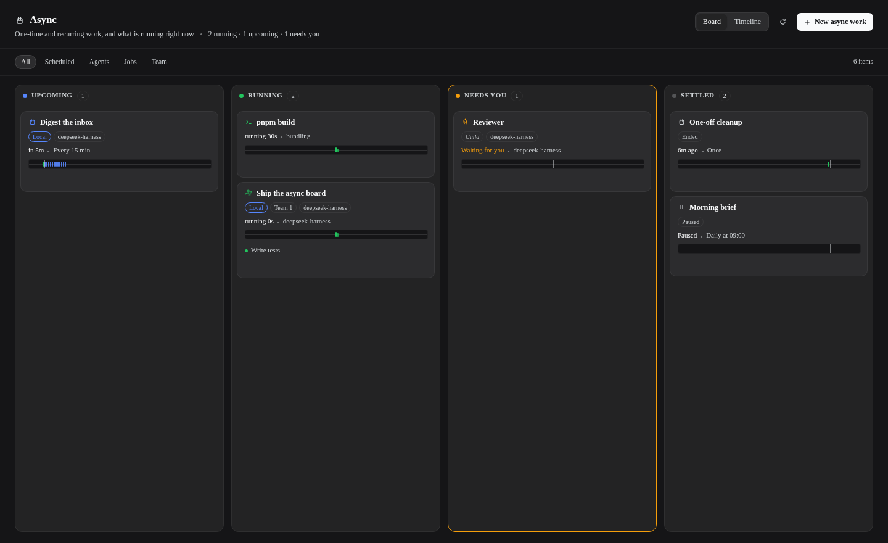
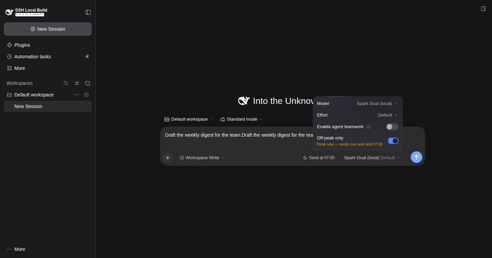

# AI Efficiency

Get more useful work out of the AI capacity you already pay for.

A Claude subscription window opens with your first message and resets five hours later.
Nobody plans that first message, so windows start wherever it happens to land, and a
heavy afternoon is often spent waiting on a window that opened late in the morning.

This project is a Claude Code skill
that does three things:

1. **Analyses** how you actually use Claude, from the transcripts already on your machine.
2. **Recommends** the daily 5-hour cycle that puts the most fresh windows under your
   working hours.
3. **Acts on it**, with your approval: a small keeper sends a Haiku "hi" about a minute
   after each reset, so the cycle holds without you thinking about it.

If you also use the **DeepSeek Harness**, it recommends two plugins included here: an
**Async** board for everything that runs without you, and an **Off-peak** switch in the
model menu that queues a prompt for the next off-peak window.

## What it found on my own usage

Thirty-one days of my Claude Code transcripts, replayed minute by minute:

| | No keeper | Recommended cycle |
|---|---|---|
| Schedule | windows start with the first prompt | wake-ups at 06:30, 11:31, 16:32, 21:33 |
| 5-hour windows my work touched | 41 | **56 (+37 %)** |
| Time stopped at the limit | 4.5 h | 2.5 h |

The busiest hours were 10:00, 14:00, 18:00 and 21:00–22:00; the cycle rests from 02:30 to
06:30, when I do. Your numbers will differ. That is the point of running the analysis
instead of copying a schedule.

One caveat on the last row: the size of a window is estimated from the limit notices in
the transcripts, and my month had only one, so treat it as indicative.

## What it does not do

- It does not raise any limit. Each window holds what it always held, and the weekly
  limit is untouched. It only changes *when* windows start.
- If you regularly reach the weekly limit, more 5-hour windows will not help, and the
  skill tells you so instead of installing anything.
- The replay sees Claude Code on the machine it runs on. Use from a phone or claude.ai is
  invisible to it (the keeper itself follows those windows correctly, because it reads the
  real reset time).

## Install

```sh
git clone https://github.com/xSubahx/ai-efficiency
cd ai-efficiency && ./install.sh
```

Then, in Claude Code:

> analyse my Claude usage and recommend a 5-hour cycle

or run the analysis yourself:

```sh
python3 skills/ai-efficiency/scripts/analyze.py
```

```
When you work (share of demand by local hour)
  09  #####################                     5.7%
  10  ###################################       9.5%
  ...
Today, with no keeper : your work touched 41 separate 5-hour windows
Recommended cycle     : wake-ups at 06:30, 11:31, 16:32, 21:33  (quiet 02:30-06:30)
                        -> 56 windows with work (+37%)
Keeper settings: --anchor 06:30 --until 01:30
```

Python 3.9+ and the Claude Code CLI, signed in with a subscription. No packages to install.

## The keeper

```sh
skills/ai-efficiency/scripts/install-keeper.sh --anchor 06:30 --until 01:30
claude-window-keeper next      # the next 24 hours of wake-ups
claude-window-keeper status    # current window, weekly use, recent pings
```

- **One machine per account.** The window belongs to the account, so run the keeper on a
  single always-on machine and every device benefits.
- **Small.** Each wake-up is the official `claude` CLI in print mode with Haiku, no tools
  and an empty working directory; a few hundred tokens.
- **Follows the real clock.** The next ping is timed from the reset Claude Code reports,
  not from a fixed timetable, so a window you open from your phone is followed too.
- **Rests at night.** Five hours does not divide a day, so an unbroken chain drifts about
  an hour a day. A daily anchor re-aligns it, and on my data scored higher than chaining
  around the clock (56 against 54).
- **Yours to steer.** `pause`, `resume`, skip a day (`set --date 2026-12-01 --off`), or
  give one week a different rhythm (`set --date D --days 7 --anchor 08:00 --until 03:00`).

On Linux it installs a systemd user service; anywhere else it prints a crontab line.

## DeepSeek Harness plugins

| | |
|---|---|
|  |  |
| **Async**: schedules, agents, background jobs and team tasks as one board and one timeline. | **Off-peak**: a per-chat switch in the model menu; at peak, `Send at 07:00` queues the draft for the next off-peak window. |

```sh
dsh plugin --profile web add "$PWD/dsh-plugins/async"
dsh plugin --profile web add "$PWD/dsh-plugins/offpeak"
```

The peak calendar ships as Monday–Friday 04:00–07:00 and 09:00–13:00, Asia/Riyadh. Set
your own in `dsh-plugins/offpeak/src/sections/01-preamble.js` and run `node build.mjs`.
More in [references/deepseek.md](skills/ai-efficiency/references/deepseek.md). Built and
tested against DSH 0.2.2.

## Layout

```
skills/ai-efficiency/
  SKILL.md                         the skill: analyse, recommend, act
  scripts/analyze.py               transcript replay and schedule search
  scripts/claude-window-keeper     the wake-up daemon
  scripts/install-keeper.sh        installs it with the recommended cycle
  references/deepseek.md           when and how to add the two DSH plugins
dsh-plugins/async/                 Async board
dsh-plugins/offpeak/               Off-peak switch
```

## Privacy

Everything runs locally. The analyser reads timestamps, model names and token counts from
your transcripts and writes nothing. The keeper sends one word to Claude and stores its
own ping log under `~/.local/state/claude-window`.

## Related

[At What Cost](https://github.com/xSubahx/at-what-cost) estimates the tokens, cost, time,
CO₂ and water of an agent task before you run it.

MIT licence. Not affiliated with Anthropic or DeepSeek; check your plan's terms before
automating anything on it.
